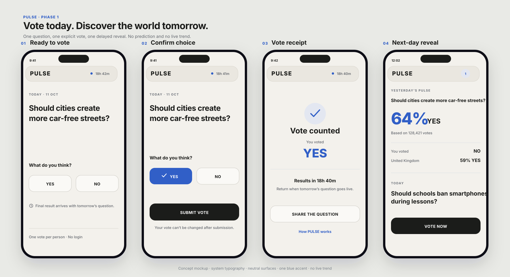

# PULSE Phase 1 launch UX

## States

1. **Ready to vote:** question, equal YES/NO options, and explicit result timing.
2. **Confirm choice:** selection is visible and requires an explicit submit action.
3. **Vote receipt:** confirms the accepted vote without exposing a trend.
4. **Next-day reveal:** yesterday's result leads directly into today's question.

## Visual system

- One blue accent (`#2864FF`) plus neutral surfaces and text.
- System typography for international coverage and platform familiarity.
- Solid content surfaces; translucency is limited to the compact top chrome.
- YES and NO never rely on green/red semantics.
- Controls are designed to exceed 44 logical pixels in height.

## Figma handoff

Drag `pulse-phase1-launch-flow.svg` into Figma. Figma imports the SVG as editable vector and text layers. Treat it as a UX direction, not production measurements; spacing and type must still be validated on representative iOS and Android devices and with translated strings.
