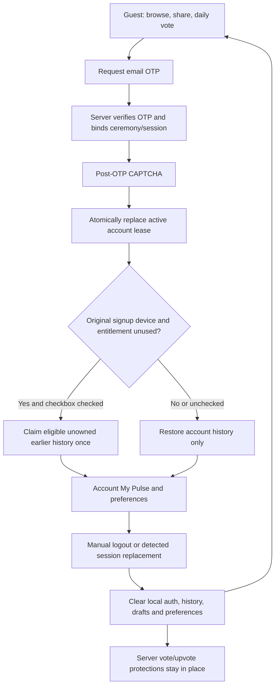

# Approved product journeys — implementation and rollout

24 October 2026. This supersedes the October 24 review's “no code yet” status for the scope approved in the subsequent instruction. Code is on `feat/approved-product-journeys`; applying migrations, deploying services and rebuilding an app are separate steps. No hosted database or external dashboard was changed by this work. See the [validation evidence](validation-product-journeys.md).

## Implemented behavior

| Area | Behavior |
| --- | --- |
| Guests | Daily YES/NO voting stays available. Browse and share Brewing/Past Results. My Pulse shows locally saved accepted guest answers. Submitting/upvoting Brewing requires a verified account. |
| Account creation | The history checkbox starts **checked**, as requested. Only the account's original signup device has an import entitlement; explicit decline or the first completed sign-in consumes it. An OTP resend on that device preserves the entitlement. Existing-account logins never import, even with the checkbox checked. |
| History ownership | Import only earlier, unowned votes since the device's latest reset epoch. Never steal raw or canonical history belonging to another account. Existing canonical history is preserved; this migration cannot retrospectively determine whether older automatically claimed history belonged to someone else. |
| Login | Server verifies the actual OTP and binds its session to the email/device ceremony. A fresh, purpose/session/target/consent-bound CAPTCHA follows. Only then does one atomic operation replace the active session and apply the signup import choice. Requesting a code or failing CAPTCHA leaves the previous device's lease intact. |
| Logout/reset | Manual logout revokes the lease before clearing auth storage, nickname, history, drafts, cached queries, local preferences and result dismissals. Automatic replacement does the same local reset when detected. Saved account history/preferences remain in the database. In-flight local writes are drained and stale writes rejected. The SecureStore installation credential and server anti-abuse rows survive. |
| Duplicate checks | Separate recognized-device/question and account/question checks remain. Imported canonical history also counts. A duplicate never claims another account's answer; private answers are redacted after reset. No blanket next-day login/logout ban. |
| Sessions | Every private REST request checks the current Pulse lease; gateways check it again within the writing transaction. Realtime notices prompt logout; foreground polling every 15 seconds and reconnect checks provide fallback. Server authorization changes immediately upon committed replacement; an offline device cannot receive an immediate UI update. Backgrounded devices reset when they reconnect. |
| Upvotes | Confirm the complete question before CAPTCHA. Cancel costs nothing. One per account **and recognized device** per UTC day; switching accounts/clearing storage does not refund it. Independent latest-use quota rows also survive candidate/voter deletion; known legacy device associations are conservatively backfilled, while previously unrecorded device identity cannot be reconstructed. Own-account cards are disabled; the server rejects self-upvotes. Exact retries reconcile to the existing vote. Other buttons disable after authoritative confirmation; lost responses can reconcile through the allowance. Same still-open non-owned question can be supported again on another UTC day. |
| Asking | Top-right `+`; a guest can tap the unavailable control for a sign-in explanation. Separate Ask/Back screen preserves the local draft and previous feed state. 180 grapheme clusters, NFC normalization and a separate 4096-byte bound; the same pinned Unicode segmenter runs on client and gateway. No language-hostile minimum length. |
| Suggestions | Debounced, cancellable, public-only PostgreSQL trigram/substring search over source question text; at most six suggestions. Query keys isolate stale responses. Approximate matches are suggestions; exact active duplicates are serialized/rejected. No AI request per keystroke and no claim of cross-language semantic search. |
| Review | New/edited submissions stay private pending review. Optional AI safety worker publishes low-risk content; missing secrets/outages/uncertain output leave it pending for a human. Moderator/Admin review records actor, revision and reason. Published-at eligibility prevents late-reviewed content entering a past midnight selection. Publishing never reserves a date or overrides the community ranking. |
| Sharing | Native system share sheet and Copy link. Public occurrence links follow submission → Brewing → live → finalized results. In-app routing opens and highlights the exact question; changing feed filters clears the pin. Removed/pending content stays unavailable publicly. No private answer, email, device ID or automatic nickname attribution in shares. |
| No installed app | A deployable Cloudflare Worker supplies a public question landing page, the appropriate store button and an Open in PULSE action. Android/iOS verified links depend on real domain/signing configuration. Embedded browsers may require Open in browser. After installation, tap the original link again; automatic deferred-link restoration is not promised. |
| Home | Yesterday's finalized result is a compact, explicitly dismissible teaser below today's voting flow. Past Results keeps it. |
| My Pulse | Member views: answered, upvoted and asked activity, selected-question status, totals and a labelled majority-alignment bar after ten finalized non-tied answers. Ties excluded from that denominator. No representative-world/population claim. Guest history is local and starts empty after logout/reset. |
| Preferences | Brewing and Past Results each use **one** list/grid toggle, default list. Guest choices persist locally; member choices sync in DB, including theme/language/accessibility. Large text temporarily uses a list while preserving a saved grid choice. |
| Accessibility/tablets | Tablets remain supported. OS font scaling plus Larger text, High contrast and Reduce motion options. Enlarged inputs, non-color status labels and accessible action names. Native layout, screen-reader, RTL and 200% text acceptance still need device testing. New static copy is provided for the ten configured languages; native-speaker review remains advisable. |
| Roles/names | Stored old `admin` becomes `moderator`; old `superuser` becomes `admin` in one forward migration. Historical audit evidence keeps original values with a documented interpretation. Product terminology is Announcements. Admin-management and Announcements publishing/delivery remain their separately scoped features. |
| Storage | One logical votes table with separate account/device uniqueness. Finalized results use the existing `question_results` snapshots. No table per question or speculative partitioning. Private account/device association uses account UUID + recognized installation, never email as the identity key. Associations retain at most 20 recent devices per account and prune inactive associations older than 180 days at sign-in; underlying vote protection is independent. |

A device means the existing best-effort Android ID/IDFV signal, HMACed with a server pepper. A modified client can forge that input. Play Integrity/App Attest remain required for stronger application/device assurance and need the owner setup already tracked in the attestation issue. CAPTCHA is not platform attestation or proof of a unique human. Different people sharing one device share its daily upvote allowance; one person with many devices/email accounts is not made unique by this change.

## Deploy in order

1. Merge/review the branch and pull it locally. Use `npm ci`, `npm run typecheck`, `npm run lint`, `npm run test:security`. Tests require Node >=22.13. Rebuild native binaries because `expo-clipboard` is a native dependency.
2. Confirm the linked Supabase project is the project in the app's current `EXPO_PUBLIC_SUPABASE_URL`. Do not assume an older CLI link or earlier chat project is still correct. Use your existing Supabase login/project selection; never put a service key in `EXPO_PUBLIC_*`.
3. Use a coordinated development maintenance window for the migrations and gateway deploy; old service RPC signatures are retired. Run:

   ```sh
   npx supabase db push --dry-run
   npx supabase db push
   ```

   The three new migrations are `202610240001_account_sessions_and_ownership.sql`, `202610240002_brewing_journeys.sql`, and `202610240003_preferences_and_activity.sql`. Existing account sessions must sign in again with the updated app. Older app versions do not implement the new account ceremony/role mapping; distribute the new build.
4. Deploy the functions to that same project:

   ```sh
   npx supabase functions deploy vote
   npx supabase functions deploy account
   npx supabase functions deploy community-action
   npx supabase functions deploy moderate-submissions
   ```

   Keep existing `DEVICE_FINGERPRINT_PEPPER` unchanged. Existing `TURNSTILE_SECRET_KEY` and `TURNSTILE_EXPECTED_HOSTNAME` must match the HTTPS verification page/widget already used by daily voting. The new actions use that same `pulse-vote` widget action with a different purpose-bound cdata. No widget secret belongs in the app or public link worker. Edge platform-supplied Supabase service/anon variables are server-only.
5. In Supabase Authentication, keep Email enabled, use a six-digit OTP template containing `{{ .Token }}`, and check email delivery/rate limits. The app verifies OTP through the account gateway before displaying its post-OTP CAPTCHA. Enabling Supabase's separate built-in **pre-email** CAPTCHA requires an additional sending-flow integration; this change does not silently enable that dashboard setting. Check Realtime includes `public.account_session_notices` (migration adds it if the publication exists). The migration sets the Authenticator role's `pgrst.db_pre_request` guard and reloads config; verify it below rather than assuming a dashboard single-session option alone is sufficient.
6. Optionally enable automated safety triage with server-only `OPENAI_API_KEY` and a strong random `MODERATION_WORKER_SECRET`. Apply the worker secret to both functions' project secrets. The community gateway invokes the worker after intake. Without these, submitted questions remain in **Pending questions** for human review. Bootstrap trusted roles through SQL Editor:

   ```sql
   insert into private.community_roles(user_id, role)
   select id, 'admin' from auth.users
   where id = '<verified-owner-user-uuid>' and email_confirmed_at is not null
   on conflict (user_id) do update set role = excluded.role;
   ```

   Use `moderator` for a Moderator. Do not use the old `superuser` role string. In the updated app, open Brewing → Pending questions to review with a reason. Neither role can schedule the winner. Safety classification is not semantic deduplication, fact-checking or perfect moderation; inspect provider/model quality for all ten languages before enabling automatic publication broadly.

## Public links — Android and iOS

1. Choose a stable HTTPS domain for links and deploy `services/question-links/worker.mjs` with the included Wrangler configuration. This is a different service from the Turnstile verification page. Configure the worker's **public** `SUPABASE_URL` and `SUPABASE_PUBLISHABLE_KEY`. It never uses a service key.
2. Set `PLAY_STORE_URL` and, when available, `APP_STORE_URL` to the real listings. If the iOS listing does not exist yet, leave it unset; the worker must not invent a listing. There is no universal public store URL for an unpublished internal preview APK. Use your internal distribution link separately while testing.
3. Android: obtain the installed preview build's certificate SHA-256 using `apksigner verify --print-certs path/to/pulse.apk`. Put colon-separated fingerprints in worker `ANDROID_SHA256_FINGERPRINTS` (comma-separated for multiple certificates). Add the **Play app-signing** certificate for Play-distributed builds; it can differ from the upload/preview certificate. Visit `https://<domain>/.well-known/assetlinks.json` and verify package `com.pulse.worldtoday` and fingerprints.
4. iOS: after Apple signing is ready, set worker `APPLE_TEAM_ID` to your ten-character team ID. Visit `/.well-known/apple-app-site-association`; it must identify `<TEAM>.com.pulse.worldtoday` with `/q/*` paths and return JSON directly, without redirects. Unconfigured Apple association intentionally returns 503. Simulator builds do not establish physical-iPhone/store-link acceptance.
5. Set app/build `EXPO_PUBLIC_SHARE_ORIGIN=https://<domain>` and rebuild. `app.config.js` derives Android verified intent filters and iOS associated domains from that origin. Include the variable in EAS preview/production environments as well as local `.env`. Build config and worker must use the same domain. Expo Go cannot establish your app's verified domain association; test the signed preview/development app.
6. Android/iOS installed: share a question to a messenger, tap it from the OS browser and at least two embedded browsers, then verify the exact card. Repeat after that submission becomes live, then finalized. Uninstalled: verify the public landing and correct store button. Desktop: both available store options. Removed: unavailable page with no cached/private content. A previously downloaded social image/link preview cannot be recalled by a database change.

The link worker and store/domain/signing configuration are prepared, not deployed from this session. Public linking remains unavailable until configured; the app shows an explicit configuration message rather than fabricating links.

## Manual security and UX acceptance

- On device A, cast a guest vote; create a **new** email account on A with the checkbox checked, then complete OTP/CAPTCHA. My Pulse contains that vote once. Repeat separately with the box unchecked: it is not imported. Resend OTP before the first completion and repeat.
- Make an unowned guest vote on a different device; log into an **existing** account there with the box checked. It restores only account history. Logging out deletes all local history/preferences/drafts, but the current daily question still cannot receive a second device vote. A later new guest vote must have null raw account ownership and must not enter the signed-out account's history.
- Log into the same account on device B. A should reset promptly online; check fallback after 15 seconds, and again after airplane mode/background reconnect. Retain an old A JWT for an operator test: private REST RPCs must reject it and old gateway writes must fail. Confirm requesting an OTP or failing/cancelling CAPTCHA does not log A out.
- Ask a short Hindi/Chinese/Arabic question and a 180-grapheme emoji question. Check 181 is rejected by gateway, private pending visibility, exact duplicates, suggestions and race/late replies, Back draft preservation, publishing/holding with reason, and no eligibility before publication.
- Upvote: own card disabled; confirm/cancel; CAPTCHA failure; repeated tap; dropped response after server commit; account switch and app storage clear on same recognized device; exactly one account/device/day event; next UTC day can support the same remaining question again. Large-text list fallback must not overwrite saved grid choice.
- Verify My Pulse totals, majority denominator excluding ties/unfinalized answers, no private answer in public share, explicit yesterday dismiss, and one toggle per screen across restart/account change.
- Use the earlier [journey matrix](reviews/2026-10-24/journeys-and-manual-tests.md) for additional paths; its login-day ban comparison and unchecked import recommendation were superseded by the owner's checked checkbox/no-wait decisions here.

## Session lifetime, CAPTCHA and engagement decisions

[Read the follow-up analysis](session-captcha-engagement.md). Supabase Auth is the authentication provider; Cloudflare Turnstile is the human-challenge provider. This change does not silently configure a 30/90-day session expiration policy or start engagement analytics. The implemented Pulse lease adds one active account session independently of the provider's JWT/refresh settings.

## Account flow



If CAPTCHA is cancelled after valid OTP, its unactivated provider session stays in memory briefly so the user can retry CAPTCHA without consuming the same OTP again. It is not persisted before successful lease activation. Expired ceremonies require a new code. A lost completion response can retry the same operation; changing its recorded import decision cannot replay it as a different decision.
