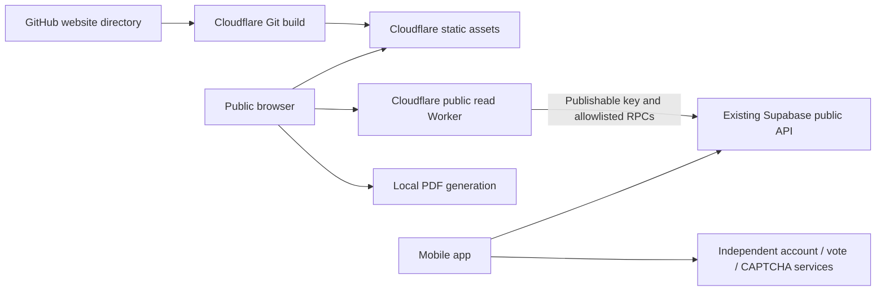

# Public website requirements and implementation

6 November 2026. Implements the approved GitHub `website/` + Cloudflare approach. A multi-hour website outage is acceptable and must not affect mobile voting, authentication recovery or verified app links. No second hosting provider, failover service or website login is introduced.

## Public journeys

| Visitor goal | Implemented route/behavior |
| --- | --- |
| Understand Pulse | Today hero, daily rhythm, About, participation/privacy explanations |
| See what is live | Current question, server-derived countdown, explicit 00:00 UTC boundary; no in-progress totals |
| Explore community questions | Brewing cards with UTC timestamps/exact cumulative upvotes; ordering, time filter, list/grid and public sharing |
| Find a previous conversation | Search public original source text across live, Brewing and past; unavailable items reveal no private details |
| Examine finalized results | Exact counts, percentages, outcome, UTC dates; inclusive date range, text/outcome/participation filters, pagination |
| Keep a report | Preview and download individual or loaded-result PDFs; browser print/save option; explicit batch scope |
| Share a question | Website-only public permalink; selection follows submission transition via existing public resolver |
| Get the app | Genuine configured store links; omit buttons for unavailable listings |
| Read comfortably | Responsive layout, local appearance/text/view preferences, keyboard semantics and native-script question text |

All visitors see the same public data for the same filters/language. No vote submission, Brewing write, login, account management, personal history or Moderator/Admin controls exist on the website. Question-language choices request existing published translations; English website chrome is a stated first-release limit. “Trending” is implemented as clearly labelled **Most supported** cumulative ranking, not a fabricated recent trend score.

## Architecture

Public API responses are projected to nonpersonal fields. No service key or browser identity is used. Successful responses cache for at most 20 seconds and never across the UTC boundary. Browsing auto-refreshes at UTC rollover and after stale/background/reconnect checks. No new migrations or changes to mobile runtime behavior are required.

Deployment instructions, known limitations, cost boundaries and acceptance criteria are in [website/README.md](../website/README.md). Website source is prepared and tested locally; hosted deployment and real-project acceptance are distinct steps. The requirement document does not claim a live site or hosted load-test result.
