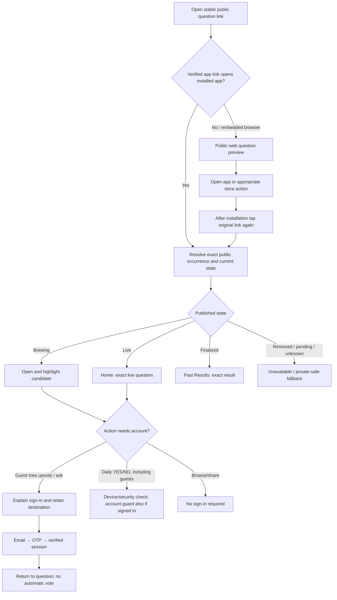
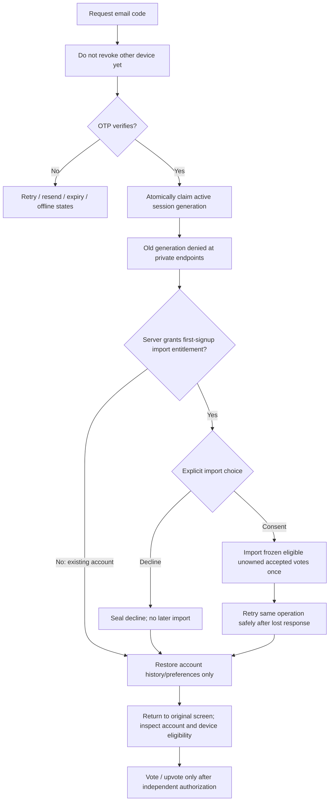
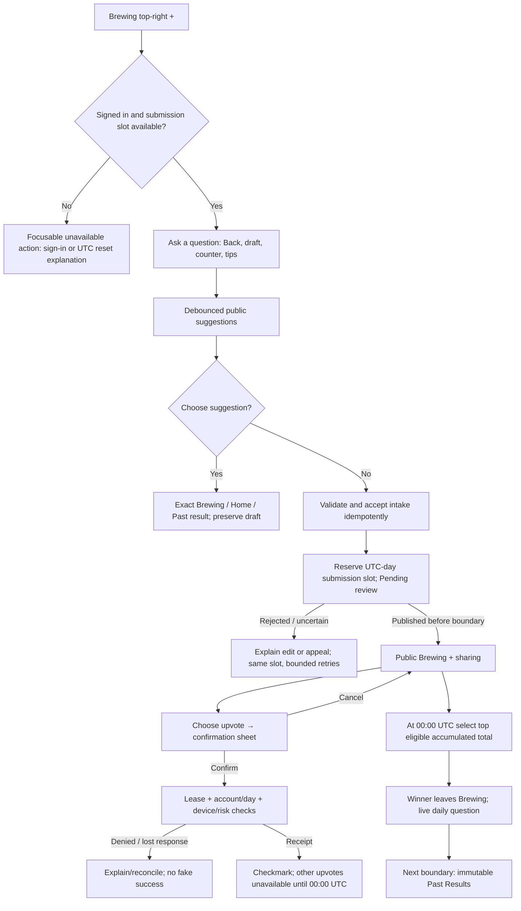
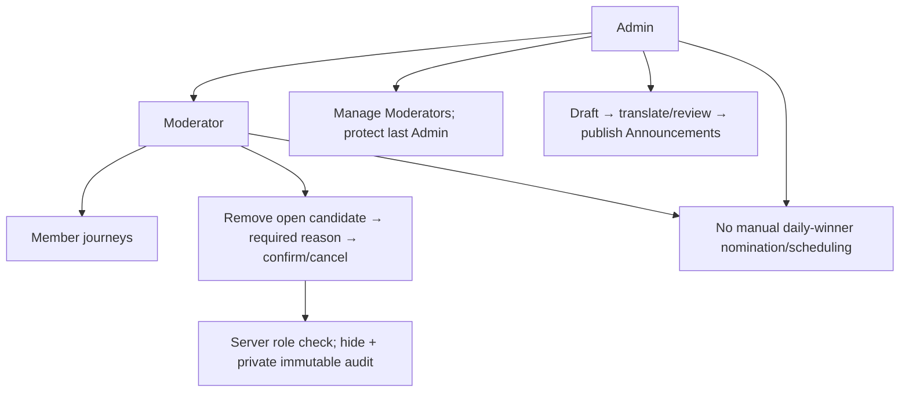

# Journeys, wireframes and manual acceptance matrix

**Review-only.** Role labels here are Guest → Member → Moderator → Admin. The owner confirmed guest daily YES/NO voting; only Brewing submissions/upvotes require sign-in. Default no login-day ban; the preview exposes a comparison of that optional policy. Every path still needs real server authorization before a write.

## Entry and sharing

## Authentication/import/session handoff

## Question/upvote lifecycle

## Moderator/Admin boundaries

## Screen wireframes

| Screen | Primary structure | States and exit |
| --- | --- | --- |
| Home | Today question → eligible answer action → confirmed receipt/countdown; compact yesterday teaser below; Announcements bell | Guest daily vote/receipt, sign-in explanation for account actions, no live question, offline cached, already voted, unavailable/security retry; yesterday dismiss only hides that result |
| Brewing | Top title and right **+**; compact sort/filter and List/Grid; open list or two-column cards with full wording/time/count/share | Guest + explains login, own/used/locked upvotes, pending own submission, confirm/cancel, no match/loading/error, moderator removal |
| Ask a question | Top-left Back; label/textbox; 180-grapheme proposed counter; live public suggestions; brief tips/reset info; Submit | Back preserves draft, invalid/duplicate suggestion, pending intake, review/edit/appeal, share only after publication |
| Past Results | Sort/filter, independent List/Grid; finalized totals/denominator and share; exact result detail | Public access; hide private user's answer for guests; zero-vote/tie, removed-content policy, missing translation, deep-link highlight |
| My Pulse | Member tabs: Daily answers / Upvotes / Asked / Selected; counts and accessible summaries | Guest device-only accepted history / empty benefits state; empty/low sample; ties excluded from majority alignment; unavailable linked content |
| OTP | Same public email-code flow for all; session replacement explanation; conditional new-account import choice | Invalid/expired/offline/resend; server new-account determination; no account-enumerating email check; optional wait-policy comparison |
| Settings | Account; language/theme; per-screen views; Accessibility; Announcements; logout | Guest local storage; account patch/retry; restore other device; OS accessibility honored; private cache cleared on logout |
| Announcements | Bell → list → detail; refresh; locale/version fallback | Guest neutral/Okay; member read/unread; list position preserved; Admin publish/review journey separate |

## Manual acceptance checklist

| ID | Actor / scenario | Expected outcome |
| --- | --- | --- |
| G01 | Guest opens Home/Brewing/Past Results | Public content available; no unauthorized write |
| G02 | Guest activates visually unavailable + via touch or screen reader | Readable sign-in explanation and action; no unresponsive disabled control |
| G03 | Guest tries daily YES/NO versus Brewing upvote | Eligible daily vote uses physical-device/security/duplicate checks; Brewing upvote requires sign-in. Browsing needs neither puzzle nor quota write. |
| G04 | Guest shares any public candidate/result | Native share + copy link; no private answer/name/email by default |
| G05 | Guest opens My Pulse after another account logs out | No previous account's answers; only unowned guest device history or an honest empty state |
| G06 | Guest changes layout/accessibility/language then restarts | Local settings restored; new device starts with local defaults |
| S01 | Installed app opens Brewing link | Exact item highlighted, correct filter/list position; no vote cast automatically |
| S02 | The same link's candidate has since become live/finalized | Resolver opens Home/Past Results rather than a stale missing candidate |
| S03 | No app / embedded browser / desktop | Public landing + store/open choices; no infinite redirect; install then original-link recovery |
| S04 | Removed/pending/invalid ID link | Safe unavailable page; no pending text or private moderation reason leak |
| S05 | App version cannot handle destination | Update/web fallback, not unrelated question or crash |
| S06 | Share cancelled / target drops image/caption/link | No posted-state claim; copy link still available; test WhatsApp/Messages/Telegram/Signal/Instagram separately |
| A01 | Request OTP for an existing email from another device | Existing session not ejected until verification succeeds |
| A02 | Wrong/expired/delayed code; resend/offline/rate limit | Clear recoverable state without disclosing whether email exists |
| A03 | New verified account consents to import | Only frozen eligible server-accepted unowned votes imported; totals unchanged |
| A04 | New account declines, later logs in elsewhere | No later automatic import; canonical history/preferences restored |
| A05 | Existing account signs in on a device with guest/other-account history | No import or private cache mixing; already-used device quota still respected |
| A06 | Import commit succeeds but response is lost | Same operation resumes/returns receipt, not a second import; new device cannot claim entitlement |
| A07 | Two simultaneous verified logins | One current lease; old JWT cannot authorize private writes; chosen signup entitlement is deterministic |
| A08 | Old device online/offline/background at replacement | Prompt online update; offline visual state clears at next validation; stale private action denied |
| A09 | Old device logs out after new one signs in | Old logout does not revoke newer lease |
| A10 | Daily/weekly/14-day use, 30-day inactivity, 90-day absolute limit | Proposed duration policy enforced by authenticated server activity, not background refresh/phone time |
| V01 | Eligible member confirms daily vote twice/concurrently | One account/device/question acceptance; replay receipt versus new duplicate distinguished |
| V02 | Account used Q on another device; device unused | Account check blocks another vote |
| V03 | Device used Q with another account; current account unused | Device check blocks another vote where signal recognized; identity/privacy-safe error |
| V04 | Login/logout/app storage clear/timezone change | Never resets accepted votes or quotas; no claim that changing identifiers is perfectly prevented |
| V05 | Physical-integrity/CAPTCHA/provider outage/replay/wrong binding | No write before required verification; preserve safe retry; public browsing works |
| V06 | Optional login-day lock enabled in comparison | Correct separate reason/date for votes and upvotes; not “upvote used”; UTC boundary not 24 hours after login |
| U01 | Upvote confirm/cancel/double tap | Cancel consumes nothing; sending disables confirm; only server receipt records success |
| U02 | Upvote success / response lost / another device already used allowance | Chosen marker or reconciliation; other controls unavailable with reset date; readable counts/share remain |
| U03 | Upvote own question / removed/selected target / stale session | Server denies regardless of edited client; no consumed allowance on rejected target |
| U05 | Proposed device/day upvote guard: another account on same phone | Device-used explanation; no second upvote; test shared-device exclusion as an explicit owner decision |
| U04 | Same account supports same open question next UTC day | Allowed once that day if not own; activity history records two dates, not two people |
| Q01 | Draft short/long/Unicode/RTL/combining characters | One counting contract; no cut-off proposition; accessible counter and retained draft |
| Q02 | Typeahead request 2 returns before request 1 | Current suggestions remain; stale response ignored |
| Q03 | Matching candidate/live/past suggestion selected, then Back | Exact destination highlighted; draft and original list context restored |
| Q04 | Similar wording with different negation/meaning | Suggestion only; do not falsely reject by similarity |
| Q05 | Two exact active duplicate submissions race | Transactional policy decides once; client preflight alone does not authorize duplicates |
| Q06 | Submit before midnight, publish after midnight | Submission slot stays on intake day; not eligible for boundary before published_at |
| Q07 | AI/moderation outage, rejection, false positive | Durable pending/review/edit/appeal; no unreviewed public content or unlimited AI retries |
| Q08 | Submission published and shared | Public deep link valid; own upvote unavailable; daily slot preserved after moderator removal |
| H01 | Yesterday teaser viewed, dismissed, next day arrives | Viewing does not auto-hide; dismissal targets that result; full history remains in Past Results |
| P01 | My Pulse asks/upvotes/selected/answers filters | Exact activity visible once; selected is status of original submission; public detail route correct |
| P02 | My Pulse alignment ties/zero votes/unfinalized/low sample | Defined honest denominator; no fabricated insight; text/table chart alternative |
| M01 | Moderator removes open candidate with reason / cancels | Confirm creates private immutable audit and hides; cancel does nothing |
| M02 | Regular user, forged role metadata, revoked Moderator, live poll target | Server denies privileged action; no direct winner selection or historical-vote deletion |
| M03 | Removal/upvote/finalization compete | Linearized outcome; hidden question cannot win; one audit; legitimate accepted votes not lost |
| D01 | Admin assigns/removes Moderator; last Admin deletion/race | Explicit role mapping; no self-escalation or accidental loss of all Admin recovery |
| D02 | Admin publishes Announcements with missing/stale translations | Review/version gate; pending or labelled fallback per policy; no private draft leak |
| X01 | Member per-screen list/grid, theme/language/accessibility on other device | Field-wise account restore; old account pending settings cannot overwrite new one |
| X02 | 200% text/RTL/high contrast/reduced motion/screen reader | Full wording and readable metadata; grid safely falls back; focus returns correctly after sheets |

## Automation scope

Automate representative end-to-end journeys (Maestro on preview builds), API/RLS/integration and real concurrency cases, plus pure unit tests for UTC, count/graph denominators, preferences, input normalization and state transitions. Test-only OTP tooling belongs in an isolated environment with no production backdoor. Keep real physical-device/provider/deep-link/store/accessibility acceptance. Do not claim this checklist or offline model is an executed E2E suite.
